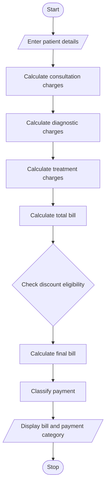

# Hospital Billing and Patient Classification

## 1. Problem Statement

Develop a Python program to calculate a hospital patient's total bill by adding consultation, diagnostic, and treatment charges. Apply concessions based on patient conditions, validate the billing details, and classify the patient according to the payment policy.

## 2. Algorithm

1. Start.
2. Read consultation, diagnostic, and treatment charges.
3. Read patient type and concession eligibility.
4. Check whether the charges are valid (not negative).
5. Calculate the total bill by adding all charges.
6. If the patient is eligible for a concession, apply a 10% discount.
7. Calculate the final bill after the discount.
8. Classify the payment:
   - Below ₹1,000 — Low payment
   - ₹1,000 to ₹5,000 — Medium payment
   - Above ₹5,000 — High payment
9. Display the total bill, discount, final bill, and payment classification.
10. Stop.

## 3. Flowchart (Mermaid TD)


print("HOSPITAL BILLING SYSTEM")

consultation = float(input("Enter consultation charges: "))
diagnostic = float(input("Enter diagnostic charges: "))
treatment = float(input("Enter treatment charges: "))

eligible = input("Eligible for concession (yes/no): ").lower()

if consultation < 0 or diagnostic < 0 or treatment < 0:
    print("Invalid charges")

elif eligible not in ["yes", "no"]:
    print("Invalid concession choice")

else:
    total = consultation + diagnostic + treatment

    if eligible == "yes":
        discount = total * 0.10
    else:
        discount = 0

    final_bill = total - discount

    if final_bill < 1000:
        category = "Low Payment"
    elif final_bill <= 5000:
        category = "Medium Payment"
    else:
        category = "High Payment"

    print("\n----- BILL DETAILS -----")
    print("Total Bill:", total)
    print("Discount:", discount)
    print("Final Bill:", final_bill)
    print("Patient Classification:", category)


## 5. Sample Input

```
Enter consultation charges: 500
Enter diagnostic charges: 1200
Enter treatment charges: 3000
Eligible for concession (yes/no): yes
```

## 6. Sample Output

```
HOSPITAL BILLING SYSTEM

----- BILL DETAILS -----
Total Bill: 4700.0
Discount: 470.0
Final Bill: 4230.0
Patient Classification: Medium Payment
```

Note: The 10% concession and payment categories are example rules for this project. You can change them to match the payment policy given by your teacher.
