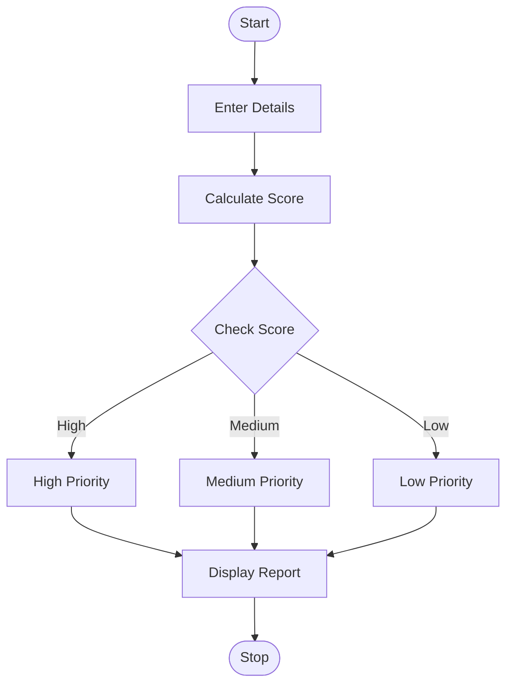

#  Integrated E-Commerce Order Processing and Reconciliation

## 1. Problem Statement

Develop a Python program to process e-commerce orders by managing product details, order quantities, discounts, dispatches, returns, and stock updates. The program should calculate the total order value, apply discounts, determine revenue after returns, identify discrepancies between expected and actual inventory, and generate a final inventory summary.

The program uses lists, dictionaries, loops, conditional statements, and functions to manage orders and reconcile inventory.

## 2. Algorithm

1. Start the program.
2. Enter the number of products and their names, prices, and initial stock quantities.
3. Enter the number of orders.
4. For each order, enter the product name, ordered quantity, and discount percentage.
5. Validate the product and check whether sufficient stock is available.
6. Calculate the gross order value and apply the discount.
7. Record the quantity dispatched and update the stock.
8. Enter the quantity returned and calculate the refund.
9. Update the stock with returned products.
10. Compare the expected stock with the actual stock and identify discrepancies.
11. Calculate total revenue after discounts and returns.
12. Display order details, revenue, discrepancies, and final inventory.
13. Stop the program.

## 3. Flowchart (Mermaid TD)




## 4. Python Source Code

```
# Integrated E-Commerce Order Processing and Reconciliationproducts = {}orders = []total_revenue = 0.0# Enter product detailsn = int(input("Enter number of products: "))for i in range(n):    print(f"\nProduct {i + 1}")    name = input("Enter product name: ").strip()    price = float(input("Enter unit price: "))    stock = int(input("Enter initial stock: "))    if not name or price < 0 or stock < 0 or name in products:        print("Invalid or duplicate product. Skipping.")        continue    products[name] = {        "price": price,        "initial_stock": stock,        "stock": stock,        "actual_stock": None    }# Process ordersm = int(input("\nEnter number of orders: "))for i in range(m):    print(f"\nOrder {i + 1}")    name = input("Enter product name: ").strip()    quantity = int(input("Enter order quantity: "))    discount = float(input("Enter discount percentage: "))    if name not in products:        print("Product not found. Order rejected.")        continue    if quantity <= 0 or not 0 <= discount <= 100:        print("Invalid quantity or discount. Order rejected.")        continue    product = products[name]    if quantity > product["stock"]:        print("Insufficient stock. Order rejected.")        continue    # Calculate order value after discount    price = product["price"]    gross = price * quantity    discount_amount = gross * discount / 100    net_amount = gross - discount_amount    # Dispatch products    product["stock"] -= quantity    returned = int(input("Enter returned quantity: "))    if returned < 0 or returned > quantity:
```

## 5. Sample Input

```
Enter number of products: 2

Product 1
Enter product name: Pen
Enter unit price: 10
Enter initial stock: 20

Product 2
Enter product name: Book
Enter unit price: 50
Enter initial stock: 10

Enter number of orders: 2

Order 1
Enter product name: Pen
Enter order quantity: 5
Enter discount percentage: 10
Enter returned quantity: 1

Order 2
Enter product name: Book
Enter order quantity: 3
Enter discount percentage: 0
Enter returned quantity: 0

Enter actual stock for Pen: 16
Enter actual stock for Book: 6
```

## 6. Sample Output

```
Gross amount: Rs. 50.00
Discount: Rs. 5.00
Refund: Rs. 9.00
Revenue from order: Rs. 36.00

Gross amount: Rs. 150.00
Discount: Rs. 0.00
Refund: Rs. 0.00
Revenue from order: Rs. 150.00

--- Inventory Reconciliation ---

Product: Pen
Initial stock: 20
Expected stock: 16
Actual stock: 16
Status: No discrepancy

Product: Book
Initial stock: 10
Expected stock: 7
Actual stock: 6
Status: Shortage of 1 units

--- Final Order Summary ---
Pen: Quantity=5, Revenue=Rs. 36.00
Book: Quantity=3, Revenue=Rs. 150.00

Total revenue after returns: Rs. 186.00

--- Final Inventory Summary ---
Pen: 16 units in expected stock
Book: 7 units in expected stock

Reconciliation completed.
```

## 7. Expected Result

- Total revenue: ₹186.00
- Pen inventory: 16 units, with no discrepancy.
- Book inventory: 7 units expected, but only 6 units counted, resulting in a shortage of 1 unit.
- Returns: Refunded amounts are deducted from revenue, and returned products are added back to stock.

