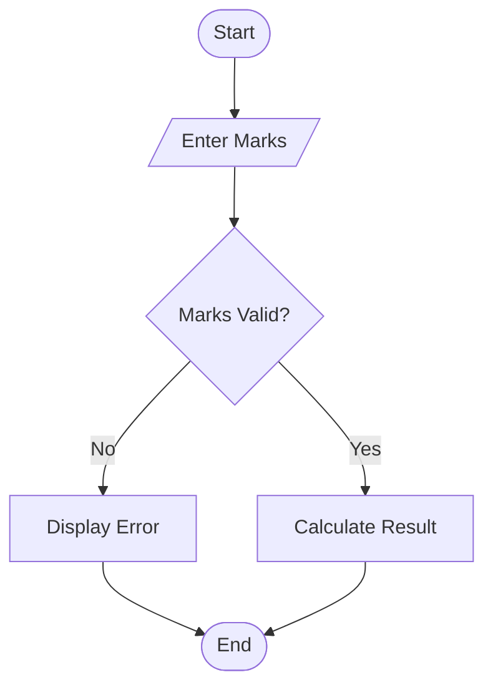

# Examination Result and Grace-Mark Validation

## 1. Problem Statement

Write a Python program to process marks in multiple subjects, check subject-wise pass criteria, apply grace marks according to a given policy, and calculate final results. Ensure that grace marks do not exceed the maximum marks of any subject. Finally, display the final marks and classification of the student.

## 2. Algorithm

1. Start.
2. Read the number of subjects.
3. Read maximum marks, obtained marks, and minimum pass marks for each subject.
4. Read the maximum grace marks allowed.
5. Check whether the student has passed each subject.
6. If a subject is failed, calculate the grace marks required.
7. Apply grace marks only if the required marks are within the allowed limit.
8. Ensure the final marks do not exceed the maximum marks.
9. Calculate the total marks and percentage.
10. Display subject-wise final marks and the result classification.
11. Stop.

## 3. flowchart (mermaid TD)


## 4. Python Source Code

```
n = int(input("Enter number of subjects: "))max_grace = int(input("Enter maximum grace marks per subject: "))subjects = []total = 0maximum_total = 0all_passed = Truefor i in range(n):    print("\nSubject", i + 1)    name = input("Enter subject name: ")    maximum = int(input("Enter maximum marks: "))    marks = int(input("Enter obtained marks: "))    pass_marks = int(input("Enter pass marks: "))    grace = 0    if marks < pass_marks:        required = pass_marks - marks        if required <= max_grace and marks + required <= maximum:            grace = required    final_marks = min(marks + grace, maximum)    if final_marks < pass_marks:        all_passed = False    total += final_marks    maximum_total += maximum    subjects.append((name, marks, grace, final_marks))print("\n--- Examination Result ---")
```

## 5. Sample Input

```
Enter number of subjects: 3
Enter maximum grace marks per subject: 5

Subject 1
Enter subject name: Python
Enter maximum marks: 100
Enter obtained marks: 32
Enter pass marks: 35

Subject 2
Enter subject name: Maths
Enter maximum marks: 100
Enter obtained marks: 67
Enter pass marks: 35

Subject 3
Enter subject name: AI
Enter maximum marks: 100
Enter obtained marks: 80
Enter pass marks: 35
```

## 6. Sample Output

```
--- Examination Result ---
Python : Original = 32, Grace = 3, Final = 35
Maths : Original = 67, Grace = 0, Final = 67
AI : Original = 80, Grace = 0, Final = 80

Total Marks: 182 / 300
Percentage: 60.67 %
Classification: FIRST CLASS
```

Note: The program uses an example policy: up to 5 grace marks per subject, with classification thresholds of 50%, 60%, and 75%. Adjust these values to match your college's rules.
