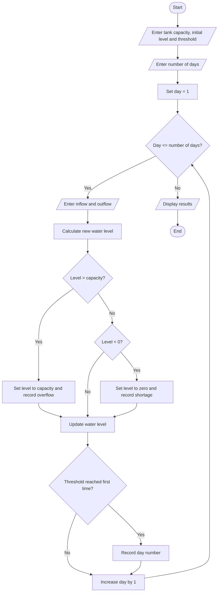

# Multi-Day Water Tank Simulation

## 1. Problem Statement

Develop a Python program to simulate water levels in a tank over multiple days. The program takes the initial water level, tank capacity, daily inflow, and daily outflow as inputs. It updates the water level each day, detects overflow and shortages, and identifies the first day the water level reaches a specified threshold.

## 2. Algorithm

1. Start.
2. Read the tank capacity, initial water level, threshold, and number of days.
3. For each day, input the water inflow and outflow.
4. Calculate the new water level using:

`New Level = Current Level + Inflow - Outflow`

5. If the water level exceeds the capacity, report overflow and set the level to the capacity.
6. If the water level becomes negative, report a shortage and set the level to zero.
7. Check whether the water level reaches the specified threshold for the first time.
8. Display the daily water level and any overflow or shortage.
9. Display the first day the threshold is reached.
10. Stop.

## 3. Flowchart (Mermaid TD)




## 4. Python Source Code

```
capacity = float(input("Enter tank capacity: "))level = float(input("Enter initial water level: "))threshold = float(input("Enter threshold level: "))days = int(input("Enter number of days: "))first_day = -1for day in range(1, days + 1):    inflow = float(input(f"Day {day} inflow: "))    outflow = float(input(f"Day {day} outflow: "))    level = level + inflow - outflow    if level > capacity:        print("Overflow detected!")        level = capacity    if level < 0:        print("Water shortage detected!")        level = 0    print(f"Day {day} water level: {level:.2f}")    if level >= threshold and first_day == -1:        first_day = dayif first_day != -1:    print("Threshold first reached on day:", first_day)else:    print("Threshold was not reached.")print("Final water level:", f"{level:.2f}")
```

## 5. Sample Input

```
Enter tank capacity: 100
Enter initial water level: 50
Enter threshold level: 80
Enter number of days: 4
Day 1 inflow: 20
Day 1 outflow: 10
Day 2 inflow: 30
Day 2 outflow: 5
Day 3 inflow: 40
Day 3 outflow: 10
Day 4 inflow: 5
Day 4 outflow: 15
```

## 6. Sample Output

```
Day 1 water level: 60.00
Day 2 water level: 85.00
Day 3 water level: 100.00
Day 4 water level: 90.00
Threshold first reached on day: 2
Final water level: 90.00
```


