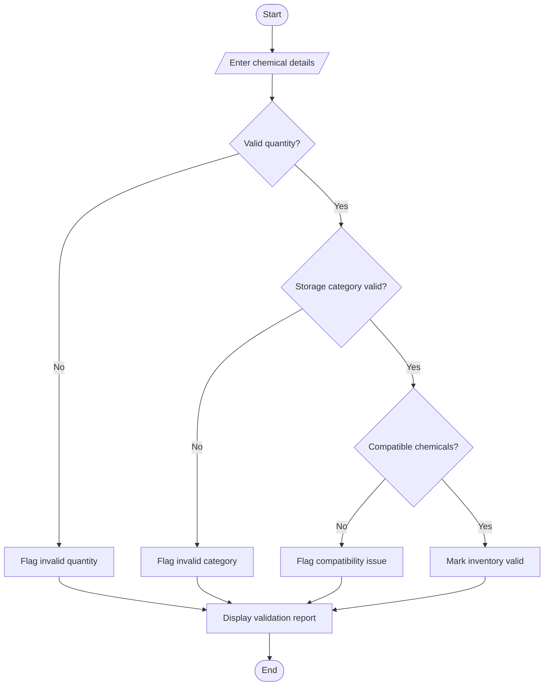

# Laboratory Chemical Inventory Validation

## 1. Problem Statement

Develop a Python program to validate laboratory chemical inventory records. The program should analyse each chemical based on its storage category, maximum permitted quantity, and compatibility restrictions. It should identify chemicals that exceed the permitted quantity, are stored in an incorrect category, or are incompatible with other chemicals stored together. Finally, the program should display the inventory status and flag invalid records.

Note: The program uses hypothetical chemical records and rules for academic purposes only. Actual laboratory storage must follow the institution's approved safety procedures and chemical safety data sheets.

## 2. Algorithm

1. Start.
2. Define the allowed storage categories and maximum quantities.
3. Define the hypothetical chemical inventory records.
4. Read each chemical's name, storage category, and quantity.
5. Check whether the storage category is valid.
6. Check whether the quantity exceeds the permitted limit.
7. Check whether any incompatible chemicals share the same storage location.
8. Mark each record as valid or invalid and display the reason for any error.
9. Display the inventory validation summary.
10. Stop.
## 3. flowchart (mermaid TD)


## 4. Python Source Code

```
# Laboratory Chemical Inventory Validation# Hypothetical maximum quantitiesmax_quantity = {    "ACID": 10,    "BASE": 8,    "FLAMMABLE": 15,    "GENERAL": 20}# Hypothetical incompatible storage categoriesincompatible_pairs = [    ("ACID", "BASE")]inventory = []n = int(input("Enter number of chemical records: "))# Read inventory recordsfor i in range(n):    print(f"\nRecord {i + 1}")    name = input("Enter chemical name: ")    category = input("Enter storage category: ").upper()    quantity = float(input("Enter quantity: "))    location = input("Enter storage location: ")    inventory.append({        "name": name,        "category": category,        "quantity": quantity,        "location": location,        "errors": []    })
```

## 5. Sample Input

Enter the following values when the program runs.

```
Enter number of chemical records: 4

Record 1
Enter chemical name: Hydrochloric Acid
Enter storage category: ACID
Enter quantity: 12
Enter storage location: Shelf1

Record 2
Enter chemical name: Sodium Hydroxide
Enter storage category: BASE
Enter quantity: 5
Enter storage location: Shelf1

Record 3
Enter chemical name: Ethanol
Enter storage category: FLAMMABLE
Enter quantity: 8
Enter storage location: Cabinet2

Record 4
Enter chemical name: Sodium Chloride
Enter storage category: GENERAL
Enter quantity: 4
Enter storage location: Shelf2
```

## 6. Sample Output

```
--- INVENTORY VALIDATION REPORT ---

Chemical: Hydrochloric Acid
Category: ACID
Quantity: 12.0
Location: Shelf1
Status: INVALID
Reason: Maximum quantity exceeded
Reason: Incompatible with Sodium Hydroxide at same location

Chemical: Sodium Hydroxide
Category: BASE
Quantity: 5.0
Location: Shelf1
Status: INVALID
Reason: Incompatible with Hydrochloric Acid at same location

Chemical: Ethanol
Category: FLAMMABLE
Quantity: 8.0
Location: Cabinet2
Status: VALID

Chemical: Sodium Chloride
Category: GENERAL
Quantity: 4.0
Location: Shelf2
Status: VALID

--- SUMMARY ---
Total records: 4
Valid records: 2
Invalid records: 2
```

## 7. Expected Result

- Hydrochloric Acid: Invalid because its quantity exceeds the hypothetical limit of 10 and it shares a storage location with an incompatible category.
- Sodium Hydroxide: Invalid because it shares a storage location with the acid.
- Ethanol: Valid according to the example's rules.
- Sodium Chloride: Valid according to the example's rules.

