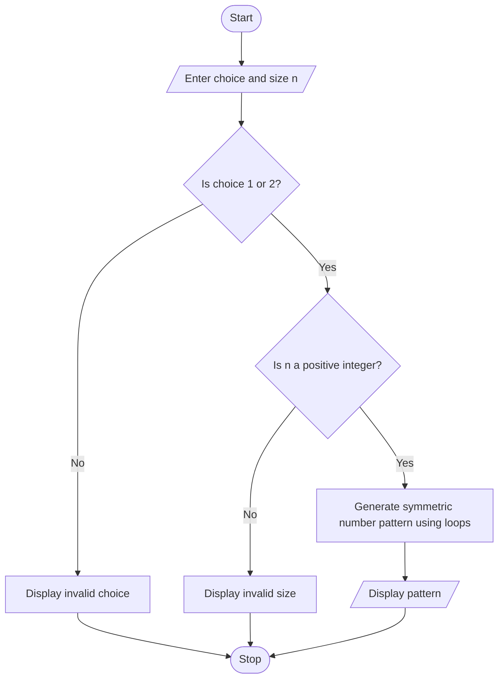

# Advanced Numeric Pattern Generator

## 1. Problem Statement

Develop a Python program to generate a hollow diamond pattern or a symmetric numerical pattern based on user-specified dimensions. The program should accept the pattern type and size from the user, validate the input dimensions, and display the selected pattern with proper spacing and alignment. If the user enters an invalid dimension or pattern type, the program should display an appropriate error message.

## 2. Algorithm

1. Start.
2. Display the available pattern types: hollow diamond and symmetric number pattern.
3. Read the user's choice and the size \\(n\\).
4. Check whether the pattern type is valid.
5. Check whether the size is a positive integer.
6. If the input is invalid, display an error message.
7. If the user selects a hollow diamond, use nested loops to print the outline of the diamond.
8. If the user selects a symmetric numerical pattern, use nested loops to print increasing and decreasing numbers with proper spacing.
9. Display the generated pattern.
10. Stop.

## 3. Flowchart (Mermaid TD)

## 4. Python Source Code

This program supports both patterns and checks invalid input.

```
# Advanced Numeric Pattern Generatorprint("1. Hollow Diamond")print("2. Symmetric Number Pattern")try:    choice = int(input("Enter your choice (1 or 2): "))    n = int(input("Enter pattern size: "))    if choice not in (1, 2):        print("Invalid choice! Select 1 or 2.")    elif n <= 0:        print("Invalid dimension! Size must be positive.")    elif choice == 1:        print("\nHollow Diamond Pattern:")        for i in range(1, 2 * n):            level = i if i <= n else 2 * n - i            spaces = n - level            if level == 1:                print(" " * spaces + "*")            else:                inside = 2 * level - 3                print(" " * spaces + "*" +                      " " * inside + "*")    else:        print("\nSymmetric Number Pattern:")        for i in range(1, n + 1):            print("  " * (n - i), end="")            for j in range(1, i + 1):                print(j, end=" ")            for j in range(i - 1, 0, -1):                print(j, end=" ")            print()except ValueError:    print("Invalid input! Enter integers only.")
```

## 5. Sample Input and Output

### Example 1: Hollow Diamond

Sample input

```
1
4
```

Sample output

```
Hollow Diamond Pattern:
   *
  * *
 *   *
*     *
 *   *
  * *
   *
```

### Example 2: Symmetric Number Pattern

Sample input

```
2
4
```

Sample output

```
Symmetric Number Pattern:
      1
    1 2 1
  1 2 3 2 1
1 2 3 4 3 2 1
```

### Example 3: Invalid Dimension

Sample input

```
1
-3
```

Sample output

```
Invalid dimension! Size must be positive.
```

## 6. Expected Result

The program successfully generates a hollow diamond or a symmetric numerical pattern according to the user's choice. It validates the input, rejects invalid dimensions, and uses nested loops and spacing to maintain proper alignment.
