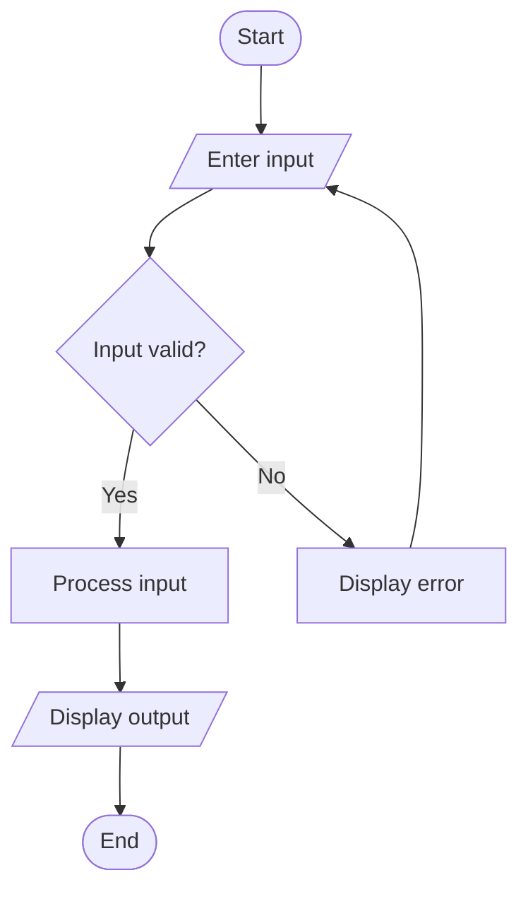

# Campus Registration Identifier Analyzer – Python Project

## 1. Problem Statement

Develop a Python program to analyze student registration identifiers and verify whether they follow a specified format. The program should extract the admission year, branch code, and student number from each identifier and classify students according to their branch and admission year.

For this project, use the following registration format:

`YYBBBSSSS`

- `YY` – Last two digits of the admission year (e.g., `26` means 2026).
- `BBB` – Three-letter branch code (e.g., `CSE`, `ECE`, `AIM`).
- `SSSS` – Four-digit student number.

Validation rules:

1. The identifier must contain exactly 9 characters.
2. The first two characters must be digits.
3. The next three characters must be valid branch codes: `CSE`, `ECE`, `AIM`, or `EEE`.
4. The last four characters must be digits.
5. Invalid identifiers must be rejected with a suitable error message.
6. Valid records must be classified by branch and admission year.

## 2. Algorithm

1. Start the program.
2. Define the list of valid branch codes.
3. Read the number of student identifiers.
4. Accept each registration identifier.
5. Convert the identifier to uppercase.
6. Check its length and validate the year, branch, and student number.
7. If invalid, display an error message.
8. If valid:
   - Extract the admission year.
   - Extract the branch code.
   - Extract the student number.
   - Display the extracted details.
9. Group valid records by branch and admission year.
10. Display the classification summary.
11. Stop the program.

## 3. Flowchart (Mermaid TD)

## 4. Python Source Code

```
def analyze_identifier(identifier):    valid_branches = ["CSE", "ECE", "AIM", "EEE"]    identifier = identifier.strip().upper()    # Validate length    if len(identifier) != 9:        return None    year_code = identifier[0:2]    branch_code = identifier[2:5]    student_number = identifier[5:9]    # Validate year and student number    if not year_code.isdigit() or not student_number.isdigit():        return None    # Validate branch    if branch_code not in valid_branches:        return None    admission_year = 2000 + int(year_code)    return {        "identifier": identifier,        "year": admission_year,        "branch": branch_code,        "student_number": student_number    }def main():    try:        n = int(input("Enter number of student records: "))
```

## 5. Sample Input

```
Enter number of student records: 5
Enter registration ID 1: 26CSE0001
Enter registration ID 2: 25ECE0012
Enter registration ID 3: 26AIM0034
Enter registration ID 4: 26XYZ1234
Enter registration ID 5: 2CSE0001
```

## 6. Sample Output

```
Valid identifier
Admission Year: 2026
Branch: CSE
Student Number: 0001

Valid identifier
Admission Year: 2025
Branch: ECE
Student Number: 0012

Valid identifier
Admission Year: 2026
Branch: AIM
Student Number: 0034

Invalid identifier: 26XYZ1234
Invalid identifier: 2CSE0001

--- Branch Classification ---
AIM : 26AIM0034
CSE : 26CSE0001
ECE : 25ECE0012

--- Admission Year Classification ---
2025 : 25ECE0012
2026 : 26CSE0001, 26AIM0034

Total valid records: 3
Total invalid records: 2
```

## 7. Result

The Campus Registration Identifier Analyzer validates student registration IDs, extracts admission year, branch code, and student number, rejects invalid records, and classifies valid students by branch and admission year.
