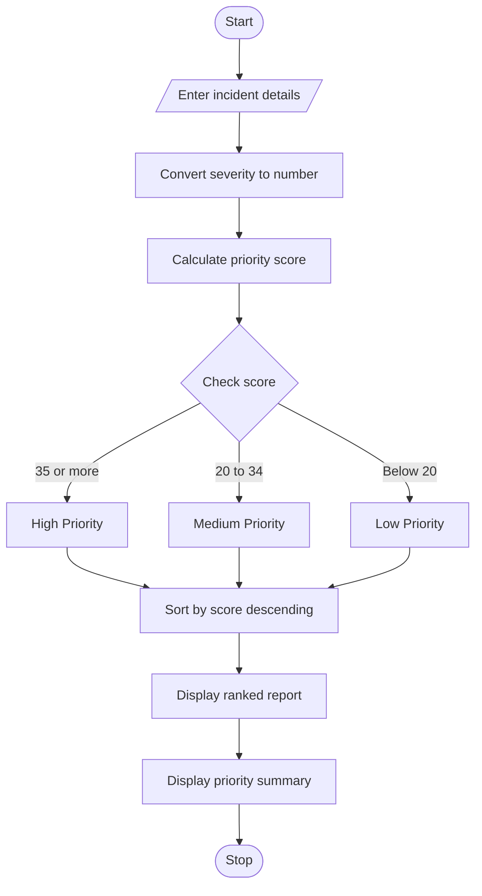

# Smart Campus Incident and Maintenance Prioritization

## 1. Problem Statement

Develop a Python program to manage campus maintenance reports such as broken lights, water leakage, damaged classroom furniture, and electrical problems. The program should collect each incident's ID, description, location, severity, and reported frequency. It should classify incidents as High, Medium, or Low priority, rank them according to predefined rules, and generate a summary showing the number of incidents in each priority category.

Predefined rules:

- Severity: High = 3, Medium = 2, Low = 1.
- Frequency: the number of times an incident has been reported.
- Priority score = (Severity × 10) + (Frequency × 2).
- Score 35 or above: High priority.
- Score 20–34: Medium priority.
- Score below 20: Low priority.
- Incidents are sorted from highest to lowest score.

## 2. Algorithm

1. Start the program.
2. Read the number of maintenance incidents.
3. For each incident, input its ID, description, location, severity, and frequency.
4. Convert severity into a numerical value: High = 3, Medium = 2, Low = 1.
5. Calculate the priority score using the formula.
6. Classify the incident based on its score.
7. Store the incident details in a list.
8. Sort all incidents by priority score in descending order.
9. Display the ranked incident report.
10. Count and display the High, Medium, and Low priority incidents.
11. Stop the program.

## 3. Flowchart (Mermaid TD)



## 4. Python Source Code

```
# Smart Campus Incident and Maintenance Prioritizationincidents = []severity_values = {    "high": 3,    "medium": 2,    "low": 1}n = int(input("Enter number of incidents: "))for i in range(n):    print(f"\nEnter details for Incident {i + 1}")    incident_id = input("Incident ID: ")    description = input("Description: ")    location = input("Location: ")    severity = input(        "Severity (High/Medium/Low): "    ).strip().lower()    while severity not in severity_values:        print("Invalid severity! Enter High, Medium, or Low.")        severity = input("Severity: ").strip().lower()    frequency = int(input("Reported frequency: "))    while frequency < 0:        print("Frequency cannot be negative.")        frequency = int(input("Reported frequency: "))    severity_score = severity_values[severity]    score = (severity_score * 10) + (frequency * 2)
```

## 5. Sample Input

```
Enter number of incidents: 4

Enter details for Incident 1
Incident ID: I101
Description: Electrical fault
Location: Library
Severity (High/Medium/Low): High
Reported frequency: 3

Enter details for Incident 2
Incident ID: I102
Description: Water leakage
Location: Laboratory
Severity (High/Medium/Low): Medium
Reported frequency: 4

Enter details for Incident 3
Incident ID: I103
Description: Broken light
Location: Room12
Severity (High/Medium/Low): Low
Reported frequency: 2

Enter details for Incident 4
Incident ID: I104
Description: Damaged chairs
Location: Classroom
Severity (High/Medium/Low): Medium
Reported frequency: 2
```

## 6. Sample Output

```
--- RANKED INCIDENT REPORT ---
----------------------------------------------------------------------------------------------------
ID      Description          Location        Severity    Frequency   Score   Priority
----------------------------------------------------------------------------------------------------
I101    Electrical fault     Library         High        3           36      High
I102    Water leakage        Laboratory      Medium      4           28      Medium
I104    Damaged chairs       Classroom       Medium      2           24      Medium
I103    Broken light         Room12          Low         2           14      Low

--- PRIORITY SUMMARY ---
Total incidents: 4
High priority: 1
Medium priority: 2
Low priority: 1
```

## 7. Result

The program successfully classifies and ranks campus maintenance incidents using severity and reported frequency. It displays the ranked list and summarizes the number of High, Medium, and Low priority cases, helping campus administrators decide which reports need attention first.
