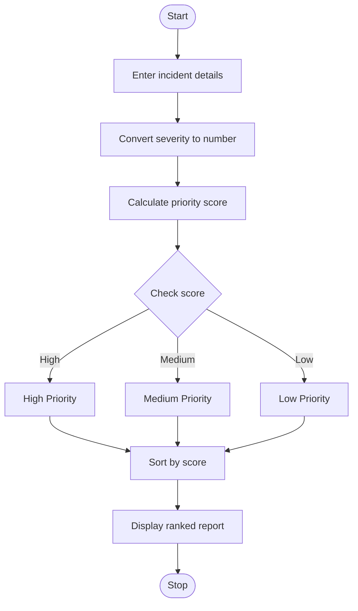

# Railway Fare and Reservation Calculator

## 1. Problem Statement

Develop a Python program to calculate railway fares for multiple passengers based on distance slabs, travel class, age-based concessions, and reservation fees. The program should also calculate cancellation penalties for cancelled reservations and display the total fare, concession amount, reservation fee, cancellation penalty, and final payable amount for each passenger.

Assumptions used in this program: The fare rates, concessions, reservation fees, and cancellation penalties are predefined for this academic project. They are illustrative values, not actual Indian Railways tariffs.

## 2. Algorithm

1. Start the program.
2. Read the number of passengers.
3. For each passenger, input their name, age, travel distance, travel class, and reservation status.
4. Calculate the basic fare according to the distance slab.
5. Apply the travel-class multiplier.
6. Calculate the age-based concession, if applicable.
7. Add the reservation fee when a reservation is made.
8. If the ticket is cancelled, calculate the cancellation penalty and the refund.
9. Display the fare details for each passenger.
10. Calculate and display the total payable amount for all passengers.
11. Stop the program.

## 3. Flowchart (Mermaid TD)





## 4. Python Source Code

```
# Railway Fare and Reservation Calculatordef calculate_basic_fare(distance):    if distance <= 100:        return 100    elif distance <= 300:        return 250    elif distance <= 500:        return 400    else:        return 600def calculate_concession(age, fare):    if age < 12:        return fare * 0.50    elif age >= 60:        return fare * 0.20    else:        return 0def main():    n = int(input("Enter number of passengers: "))    if n <= 0:        print("Invalid number of passengers.")        return    total_payable = 0    class_rates = {        "Sleeper": 1.0,        "AC3": 1.8,        "AC2": 2.5
```

## 5. Sample Input

```
Enter number of passengers: 2

Passenger 1
Enter passenger name: Ravi
Enter age: 25
Enter distance in km: 250
Enter class (Sleeper/AC3/AC2): Sleeper
Reservation required? (yes/no): yes
Ticket cancelled? (yes/no): no

Passenger 2
Enter passenger name: Sita
Enter age: 65
Enter distance in km: 400
Enter class (Sleeper/AC3/AC2): AC3
Reservation required? (yes/no): yes
Ticket cancelled? (yes/no): yes
```

## 6. Sample Output

```
--- Fare Details ---
Passenger Name: Ravi
Basic Fare: Rs. 250.00
Class Fare: Rs. 250.00
Age Concession: Rs. 0.00
Reservation Fee: Rs. 40.00
Total Fare: Rs. 290.00
Cancellation Penalty: Rs. 0.00
Refund Amount: Rs. 0.00
Final Payable Amount: Rs. 290.00

--- Fare Details ---
Passenger Name: Sita
Basic Fare: Rs. 400.00
Class Fare: Rs. 720.00
Age Concession: Rs. 144.00
Reservation Fee: Rs. 40.00
Total Fare: Rs. 616.00
Cancellation Penalty: Rs. 154.00
Refund Amount: Rs. 462.00
Final Payable Amount: Rs. 154.00

==============================
Total Payable: Rs. 444.00
==============================
```

## 7. Rules Used in the Program

| Distance     | Basic fare |
| ------------ | ---------- |
| Up to 100 km | ₹100       |
| 101–300 km   | ₹250       |
| 301–500 km   | ₹400       |
| Above 500 km | ₹600       |

| Travel class | Multiplier |
| ------------ | ---------- |
| Sleeper      | 1.0×       |
| AC3          | 1.8×       |
| AC2          | 2.5×       |

- Children below 12 years: 50% concession.
- Senior passengers aged 60 or above: 20% concession.
- Reservation fee: ₹40 per reserved ticket.
- Cancellation penalty: 25% of the total fare after concession and reservation fee.
- Final payable amount for a cancelled ticket is the cancellation penalty; the remaining amount is refunded.
  `
